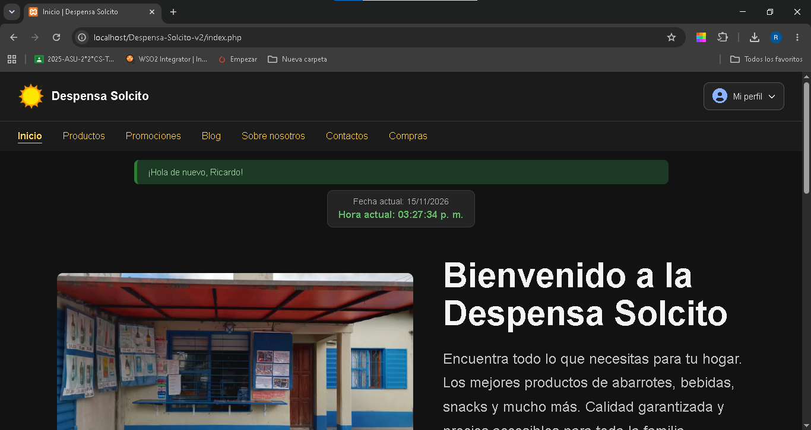
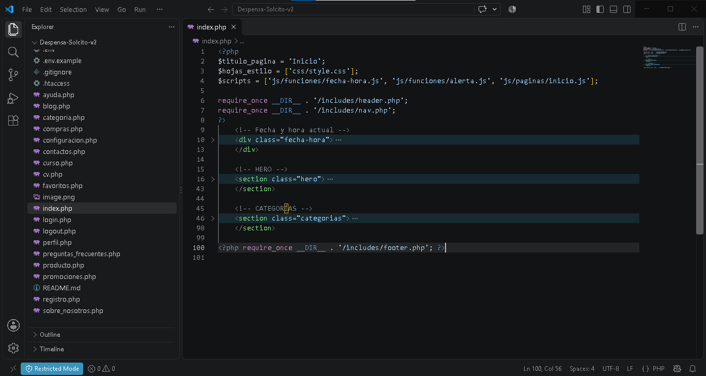
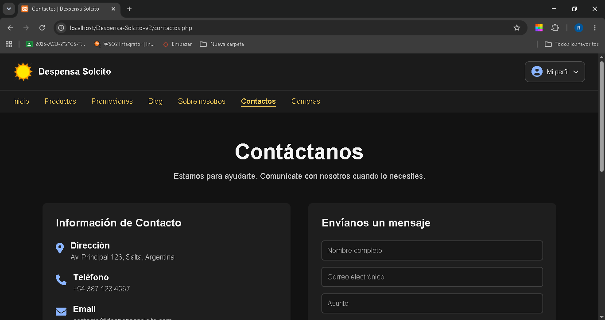
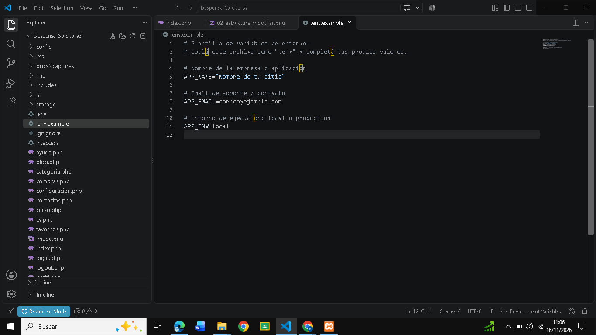

# Despensa Solcito (v2 – PHP)

Sitio web de una despensa de barrio: catálogo de productos por categoría, favoritos, promociones, blog, pedidos, contacto, cuentas de usuario y modo oscuro.

Esta versión es la **evolución del sitio estático del Hito 1**. En el **Trabajo Práctico N° 4 (Unidad 4)** se migró de HTML a **PHP** y se aplicó:

- **Modularización con Server Side Includes (SSI):** el encabezado, el menú y el pie de página viven en una sola plantilla (`includes/`) y se incluyen en todas las páginas con `require_once`.
- **Renderizado del lado del servidor (SSR):** el servidor genera el HTML con el título de cada pestaña y la opción activa del menú ya resueltos.
- **Variables de entorno (`.env`):** el nombre del sitio, el email de contacto y el entorno de ejecución se leen desde un archivo que no se sube a Git.
- **Formularios procesados en el servidor:** Contactos, Compras, Login y Registro validan y guardan los datos con PHP (`$_POST`), con protección CSRF y patrón *Post/Redirect/Get*.
- **Sesiones y cuentas:** registro, inicio y cierre de sesión, perfil y productos favoritos por usuario.
- **Páginas dinámicas:** `categoria.php?cat=snacks` genera cada categoría desde un único archivo y responde 404 si no existe.

## Prototipo en Figma

> 🔗 **Pegar aquí el enlace público del diseño:** `https://www.figma.com/design/4sGFbee4u1im6XKZ4a3s72/DESPENSA-SOLCITO?node-id=0-1&t=fGJ0qJpFmYcpDmtP-1`

## Tecnologías utilizadas

- HTML5
- CSS3 (diseño responsive y modo oscuro)
- JavaScript (validaciones, galería, resumen de formularios, tema)
- PHP 8.x
- Apache mediante XAMPP o Laragon
- Git y GitHub

## Estructura del proyecto

```
Despensa-Solcito-v2/
├── config/
│   └── env.php                 lee el .env y define las constantes
├── includes/
│   ├── header.php              <head>, título dinámico, CSS y cabecera
│   ├── nav.php                 menú principal (página activa) y avisos
│   ├── footer.php              pie de página y scripts JS
│   ├── funciones.php           sesión, avisos, CSRF, lectura de formularios, archivos
│   ├── auth.php                registro, login, sesión y favoritos
│   └── datos.php               catálogo de categorías y productos
├── css/                        style.css + un CSS por página
├── js/
│   ├── funciones/              código reutilizable
│   └── paginas/                código de una sola página
├── img/                        marca/, iconos/, productos/, fotos/
├── storage/                    datos generados (usuarios, mensajes, pedidos); no se sube a Git
├── docs/capturas/              capturas de pantalla para este README
├── index.php, producto.php, categoria.php, promociones.php, blog.php,
│   sobre_nosotros.php, contactos.php, compras.php, curso.php, cv.php,
│   preguntas_frecuentes.php, ayuda.php, configuracion.php
├── login.php, registro.php, logout.php, perfil.php, favoritos.php
├── .env.example                plantilla de variables (sí se sube a Git)
├── .env                        variables reales (NO se sube a Git)
├── .gitignore
└── .htaccess                   bloquea el acceso web al archivo .env
```

### Cómo funciona una página

Cada página define sus datos y luego incluye las plantillas:

```php
<?php
$titulo_pagina = 'Blog';
$hojas_estilo  = ['css/style.css', 'css/blog.css'];

require_once __DIR__ . '/includes/header.php';
require_once __DIR__ . '/includes/nav.php';
?>

<h1>Blog de <?= e(APP_NAME) ?></h1>

<?php require_once __DIR__ . '/includes/footer.php'; ?>
```

| Variable | Dónde se usa | Para qué sirve |
|---|---|---|
| `$titulo_pagina` | `header.php` | Texto de la pestaña: `Blog \| Despensa Solcito` |
| `$hojas_estilo` | `header.php` | CSS que carga la página |
| `$scripts` | `footer.php` | JS propios de la página |
| `$ruta_base` | las tres plantillas | `''` en la raíz y `'../'` en subcarpetas |
| `$pagina_activa` | `nav.php` | Fuerza qué ítem del menú se resalta |

## Formularios, sesiones y datos guardados

| Formulario | Qué hace el servidor | Dónde guarda |
|---|---|---|
| **Contactos** | Valida nombre, correo y mensaje; muestra errores sin perder lo escrito | `storage/mensajes.log` |
| **Compras** | Valida categoría, cantidad, fecha, entrega y términos; guarda el comprobante (JPG/PNG/PDF, máx. 2 MB); genera un número de pedido | `storage/pedidos.log` y `storage/comprobantes/` |
| **Registro** | Valida los datos y crea la cuenta con la contraseña cifrada (`password_hash`) | `storage/usuarios.json` |
| **Login** | Verifica la contraseña (`password_verify`) y abre la sesión | sesión de PHP |
| **Favoritos / Perfil** | Requieren sesión iniciada | `storage/usuarios.json` |

Medidas de seguridad aplicadas: token CSRF en cada formulario, escape de todo lo que se muestra (`e()`), identificador de sesión nuevo al iniciar sesión, validación del tipo real de los archivos subidos, y `storage/` y `.env` bloqueados desde el navegador con `.htaccess`.

> El almacenamiento en archivos reemplaza a una base de datos y es solo para este trabajo práctico. Los mensajes no se envían por correo: se guardan para que el dueño los lea.

## Instalación y ejecución local

> [IMPORTANTE] PHP necesita un servidor. Abrir los archivos con *Live Server* o con doble clic **no** ejecuta el código PHP.

1. Instalar [XAMPP](https://www.apachefriends.org/) o [Laragon](https://laragon.org/).
2. Clonar el repositorio dentro de la carpeta pública del servidor:
   - XAMPP: `C:\xampp\htdocs\`
   - Laragon: `C:\laragon\www\`
   ```bash
   git clone https://github.com/<usuario>/Despensa-Solcito-v2.git
   ```
3. Crear el archivo de variables de entorno a partir de la plantilla:
   ```bash
   cp .env.example .env
   ```
   y completar los valores (`APP_NAME`, `APP_EMAIL`, `APP_ENV`). La carpeta `storage/` se llena sola cuando se usan los formularios.
4. Iniciar **Apache** desde el panel de XAMPP o Laragon.
5. Abrir en el navegador: `http://localhost/Despensa-Solcito-v2/`

## Variables de entorno

| Variable | Ejemplo | Descripción |
|---|---|---|
| `APP_NAME` | `Despensa Solcito` | Nombre de la empresa o aplicación |
| `APP_EMAIL` | `contacto@despensasolcito.com` | Email de soporte y contacto |
| `APP_ENV` | `local` | Entorno de ejecución. En `local` se muestran los errores de PHP |

El archivo `.env` está en `.gitignore`; en el repositorio solo se sube `.env.example`.

## Evidencia de funcionamiento

### Servidor local ejecutándose


### Estructura modular (SSI)


### Navegación dinámica (título y menú activo)


### Variables de entorno


## Flujo de trabajo con Git

- Rama de trabajo: `feature/migracion-php-ssi`, integrada a `main` mediante Pull Request.
- Commits atómicos y descriptivos (por ejemplo: `feat: extrae header, nav y footer a includes/`).
